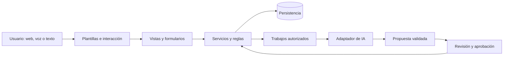

# ArquiGica

**Plataforma de planificación de eventos con Gica, el bot arquitecto.**

ArquiGica reúne organizaciones y expositores, ficha del evento, calendario,
propuestas de agenda y seguimiento de tareas. La IA propone contenido; el
servidor valida horarios, permisos y presupuesto, y conserva las versiones
aprobadas.

Proyecto desarrollado para el concurso internacional **SparkX 3.0**.

Es un prototipo funcional local. La concurrencia y el despliegue de producción
requieren las verificaciones descritas en [validación](docs/verification.md).

## Iniciar la instalación actual

Si recibiste el **Project Zip Folder**, extrae `ArquiGica_Proyecto.zip` y abre
su carpeta `ArquiGica`. Completa primero la [instalación en otro equipo](docs/guias/inicio.md#primera-instalación-en-otro-equipo).
También está disponible la [guía de instalación en inglés](docs/guias/install-en.md).

Desde esta carpeta, haz doble clic en **iniciar.cmd** o ejecuta:

```powershell
.\iniciar.cmd
```

Después abre **http://127.0.0.1:8000/** e inicia sesión con tu cuenta.
Si ya está abierto, utiliza esa dirección; el lanzador evita otra instancia
en el mismo puerto. Mantén su ventana abierta durante el uso.

Para instalar una copia nueva, usar otra cuenta administradora o resolver
problemas de arranque, consulta [Inicio e instalación](docs/guias/inicio.md).

## Estructura del código

```text
ArquiGica/
├── apps/                         Módulos de negocio
│   ├── accounts/                 Login, usuarios, roles y acceso
│   ├── events/                   Ficha, calendario y programación
│   ├── directory/                Organizaciones y personas
│   ├── planning/                 Propuestas, versiones y tareas
│   ├── assistant/                Gica, conversación y adaptadores de IA
│   ├── jobs/                     Cola, ejecución y seguimiento
│   ├── ai_management/            APIs, permisos, tokens y presupuesto
│   └── registration/             Inscripciones al evento
├── config/                       Configuración, rutas y ciclo del servidor
├── templates/                    Interfaz Django, agrupada por módulo
├── static/                       CSS, JavaScript, recursos y licencias
├── tools/                        Arranque, empaquetado y ayudante OpenCode
├── docs/                         Arquitectura, guías y validación
├── manage.py                     Entrada de comandos Django
├── iniciar.cmd                   Entrada local Windows
├── ArquiGica-presentacion.code-workspace
└── requirements*.txt             Dependencias de ejecución y desarrollo
```

Cada módulo mantiene sus pruebas en `apps/<modulo>/tests/` y sus cambios de
base de datos en `migrations/`. `var/`, `Temporal/`, `.venv/` y `entrega/`
cumplen funciones locales y quedan fuera del paquete de código.

## Arquitectura

**Monolito modular con Django MTV**, servicios de aplicación, reglas de dominio
y adaptadores para proveedores de IA. La interfaz usa plantillas, HTMX y
JavaScript. SQLite permite el piloto local; PostgreSQL es el destino de
producción y de las pruebas de bloqueos concurrentes.



El [mapa de arquitectura](docs/architecture.md) muestra responsabilidades,
archivos representativos y el recorrido exacto de arranque.

## Recorrido de presentación

1. Mostrar en este README el propósito, la estructura del código y la arquitectura.
2. Iniciar ArquiGica y entrar al portal.
3. Registrar organización y expositor; crear el evento.
4. Solicitar y revisar la agenda, preparación y comunicaciones.
5. Consultar el calendario y mostrar un cambio de expositor conservando versiones.
6. Revisar las tareas y sus instrucciones, ilustrar estados y leer los borradores de comunicación.
7. Solicitar un cambio acotado de agenda a la IA, aprobarlo y terminar en **Conoce a Gica**.

La demo vigente se inicia desde **Mis eventos → Iniciar demo con OpenAI**.
Presenta a Gica, registra **Gicaingenieros** y **Jorge Gayoso**, crea el evento
con Robert y después muestra su reemplazo por Jorge. Las conexiones y el
presupuesto se configuran desde **Gestión de IA → APIs y agentes**. Las claves
privadas son temporales en memoria y se deben volver a guardar tras un reinicio.
Las pruebas automáticas no requieren una clave ni inferencia real.

## Entregas para descargar

Los informes y las presentaciones finales están en español e inglés.
El ZIP contiene el código instalable y excluye las cuentas, los datos activos y las claves.

- [Informe del proyecto en español](https://github.com/gorge112008/SPARKX-IA/releases/latest/download/ArquiGica_Informe_Proyecto_ES.docx)
- [Presentación en español](https://github.com/gorge112008/SPARKX-IA/releases/latest/download/ArquiGica_Presentacion_ES.pptx)
- [Project report in English](https://github.com/gorge112008/SPARKX-IA/releases/latest/download/ArquiGica_Project_Report_EN.docx)
- [Presentation in English](https://github.com/gorge112008/SPARKX-IA/releases/latest/download/ArquiGica_Presentation_EN.pptx)
- [Project Zip Folder](https://github.com/gorge112008/SPARKX-IA/releases/latest/download/ArquiGica_Proyecto.zip)
- [SHA-256 del ZIP](https://github.com/gorge112008/SPARKX-IA/releases/latest/download/ArquiGica_Proyecto.zip.sha256)

## Documentación y comprobaciones

- [Índice de documentación](docs/README.md)
- [Arquitectura y guía para exponer el código](docs/architecture.md)
- [Inicio e instalación](docs/guias/inicio.md)
- [Etapas y pendientes](docs/construction-plan.md)
- [Resultados y límites de validación](docs/verification.md)
- [Paquete de código y entrega](docs/guias/release.md)

```powershell
.\.venv\Scripts\python.exe -B manage.py check
.\.venv\Scripts\python.exe -B manage.py makemigrations --check --dry-run
.\.venv\Scripts\python.exe -B manage.py test --noinput
.\.venv\Scripts\python.exe -B -m unittest tools.test_package_release
```

Para mostrar el código en VS Code, abre **ArquiGica-presentacion.code-workspace**.
Organiza el explorador y oculta datos privados, entornos y auxiliares de la vista;
no modifica su ubicación ni sus permisos.
