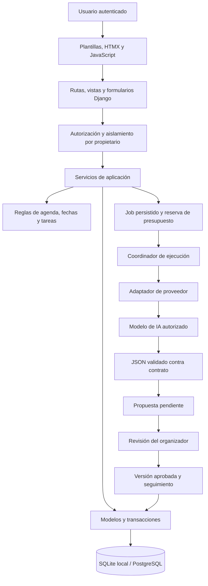
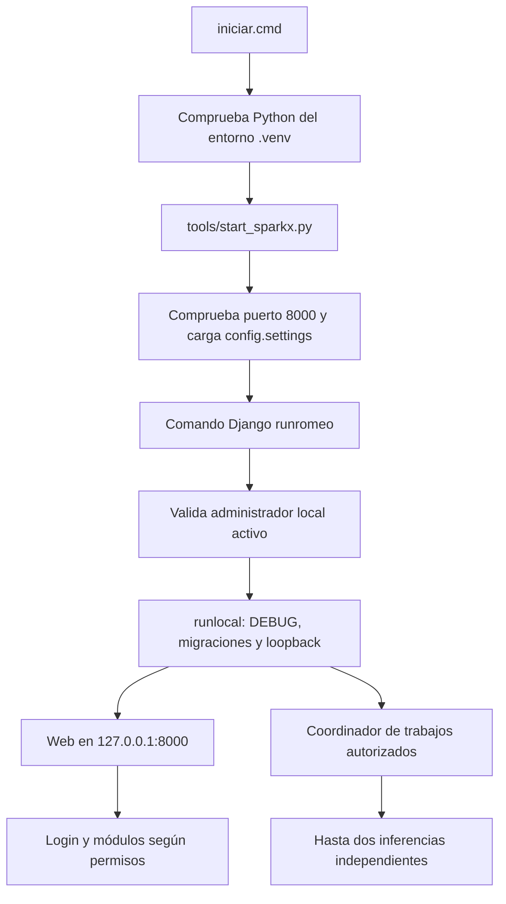

# Arquitectura de ArquiGica

ArquiGica es un **monolito modular Django**. La aplicación se despliega como una
unidad y separa sus responsabilidades en módulos de negocio. Usa el patrón
MTV de Django: modelos para persistencia, plantillas para presentación y vistas
para atender solicitudes. Los servicios concentran operaciones y transacciones;
las reglas de dominio validan decisiones antes de guardar.

Esta página presenta el código vigente. Los resultados medidos están en
[verificación](verification.md); las versiones sustituidas se conservan en el
historial de Git.

## Vista general



Las flechas representan colaboración. No son microservicios ni procesos
independientes por cada bloque. El modo local integra servidor y coordinador;
la cola permanece en la base de datos.

## Mapa de módulos

| Módulo | Responsabilidad | Archivos para mostrar |
| --- | --- | --- |
| `accounts` | Login por correo/usuario, roles y acceso de revisores | [access.py](../apps/accounts/access.py), [backends.py](../apps/accounts/backends.py) |
| `events` | Ficha, entrevista, calendario y programación | [services.py](../apps/events/services.py), [calendar.py](../apps/events/calendar.py) |
| `directory` | Organizaciones, personas, alias y asignaciones | [queries.py](../apps/directory/queries.py), [services.py](../apps/directory/services.py) |
| `planning` | Validar propuestas, aprobar versiones y seguir tareas | [domain.py](../apps/planning/domain.py), [services.py](../apps/planning/services.py) |
| `assistant` | Conversación Gica, creación guiada y contrato de IA | [guided_event.py](../apps/assistant/guided_event.py), [compact_contract.py](../apps/assistant/compact_contract.py) |
| `jobs` | Cola, ejecución y trazabilidad de trabajos | [services.py](../apps/jobs/services.py), [runromeo.py](../apps/jobs/management/commands/runromeo.py) |
| `ai_management` | Conexiones, perfiles, autorización y costes | [agent_access.py](../apps/ai_management/agent_access.py), [services.py](../apps/ai_management/services.py) |
| `registration` | Inscripciones públicas, estados y capacidad | [services.py](../apps/registration/services.py) |
| `project_checklist` | Compatibilidad con el checklist retirado del producto | Conserva sus modelos y migraciones; deshabilitado en configuración |

## Organización interna de un módulo

```text
apps/<modulo>/
├── apps.py              Registro del módulo Django
├── models.py            Entidades y restricciones persistentes
├── services.py          Casos de uso y transacciones
├── views.py / urls.py   Entradas HTTP, cuando corresponda
├── forms.py             Validación de formularios, cuando corresponda
├── migrations/          Evolución del esquema
└── tests/               Pruebas del módulo y sus límites
```

Se agregan archivos especializados cuando existe una responsabilidad concreta:
`planning/domain.py` contiene reglas sin dependencia de HTTP;
`directory/queries.py` construye consultas limitadas al propietario;
`assistant/provider.py` adapta proveedores. No todos los módulos necesitan
las mismas capas ni un archivo por cada patrón de diseño.

La presentación vive en [templates/](../templates/) y [static/](../static/),
agrupada por área. Los nombres técnicos `romeo-*` conservan contratos existentes;
el nombre visible del bot es **Gica-1**.

## Recorrido de una propuesta

1. El usuario completa la ficha mediante formulario o conversación guiada.
2. Formularios y servicios comprueban permisos, datos y revisión actual.
3. Una solicitud de IA explícita fija proveedor, contexto y límites; reserva
   presupuesto y crea un `Job` persistente.
4. El coordinador procesa el trabajo autorizado a través del adaptador.
5. El servidor valida la respuesta estructurada y las reglas del plan.
6. La propuesta se revisa y aprueba, creando una versión persistente. Un cambio
   posterior conserva la versión anterior y vuelve a pasar por validación.

Las tareas mecánicas —fechas, filtros, cálculo de horarios, costes y permisos—
se resuelven con código local. La IA ayuda a diseñar contenido. La guía por
voz/texto puede preguntar y preparar formularios; no obtiene autoridad de
superadministrador ni aprobación general por entender una frase.

## Cómo inicia el software



El lanzador estándar usa `adminjorge`; otra instalación puede indicar su cuenta
con `manage.py runromeo --username NOMBRE`. `runlocal` permite iniciar sólo la
web. El navegador se abre manualmente. Un trabajo pendiente autorizado puede
procesarse al arrancar el coordinador; abrir ArquiGica no crea por sí mismo un
trabajo nuevo.

El apagado se solicita desde el perfil administrador local o con Ctrl+C.
Espera solicitudes y trabajos en curso antes de cerrar, conserva datos y libera
las claves que estaban sólo en memoria. Instrucciones en [Inicio](guias/inicio.md).

## Límites y controles

- Los servicios autorizan contra el estado actual de la cuenta y el propietario.
  Los permisos del navegador no sustituyen estas comprobaciones.
- Planes, tareas y asignaciones usan revisiones para detectar cambios concurrentes.
- Las conexiones privadas y la gestión del presupuesto pertenecen al humano
  administrador; los agentes no pueden modificar esos módulos.
- El piloto real tiene alcance y presupuesto acotados. No acredita generación
  libre sobre cualquier evento ni ejecución de acciones externas.
- SQLite sirve al piloto de una instancia. Bloqueos, carga y despliegue de
  producción necesitan PostgreSQL y pruebas específicas.

Los detalles de [IA y presupuesto](guias/ai-management.md),
[directorio y calendario](arquitectura/directory-and-catalog.md) y
[despliegue](guias/deployment.md) amplían estas fronteras.

## Orden sugerido para presentar el código

1. **README:** problema, recorrido y estructura general.
2. **Este diagrama:** módulos, capas y separación entre reglas e IA.
3. **`apps/events/`:** modelo, servicios y carpeta de pruebas.
4. **`apps/assistant/compact_contract.py`:** entrada/salida estructurada.
5. **`apps/jobs/` y `apps/ai_management/`:** ejecución y control del consumo.
6. **Lanzador:** explicar el arranque y pasar al prototipo en el navegador.

El workspace [ArquiGica-presentacion](../ArquiGica-presentacion.code-workspace)
facilita mostrar únicamente las áreas del código; ocultar una carpeta en el
editor no cambia su contenido, su protección ni las reglas del empaquetado.
