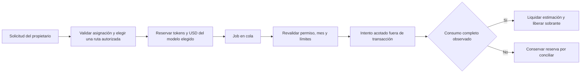

# Gestión de IA, tokens y presupuesto

Acceso desde el perfil del usuario, al pie de la barra lateral → **Gestión de
IA**. Ya no ocupa una entrada entre las herramientas comunes. Se conservan los
permisos por cuenta y la prohibición de acceso para los agentes.

## Generación compacta del seminario narrado

El guion vigente prepara primero organización y expositor en el directorio.
Después de una respuesta válida muestra **Respuesta recibida** durante tres
segundos antes de continuar, también cuando la respuesta contiene preguntas.
Este estado indica recepción validada, no aprobación del plan. Cancelación y
errores no lo presentan. La guía por voz/texto reconoce el paso y puede preparar
los formularios; no inicia generación ni aprueba por el mero hecho de conversar.
Los controles humanos y la autorización exclusiva de la demo se mantienen
separados. El ejemplo usa **Jorge Gayoso**, sin reescribir nombres históricos.

El botón principal **Mis eventos → Iniciar demo con OpenAI** muestra el prompt,
solicita la agenda y guarda una copia validada en Temporal antes de aplicarla.
Este modo `agenda-openai` aplica las propuestas del piloto fijo por autorización
expresa del organizador; no amplía los permisos generales de Gica. Si falla el
archivo o la validación, no continúa a la aprobación. Después muestra el evento
en calendario y el cambio de Robert por Jorge, sin otra consulta a la IA.

Usa el perfil principal configurado **GPT-5.4 mini**, con autorización de pago
y clave disponible. El tope **USD 1 acumulado** mantiene todo el consumo y las
reservas OpenAI anteriores, incluso de otros meses y modelos. Además se comprueban
los presupuestos mensual y del agente. Con límites 12.000/1.800, la reserva máxima
Standard es USD 0,017100 por llamada; el coste observado puede ser menor.
El formato nativo es JSON Schema estricto dentro de `result`, sin herramientas,
con `store=false` y razonamiento `none`.
[Modelo y tarifas oficiales](https://developers.openai.com/api/docs/models/gpt-5.4-mini).

Las claves se conservan en memoria. Para el recorrido real, el usuario la guardó
mediante **Gestión de IA → APIs y agentes**, sin leer ni exponer su valor. El
reinicio final para cargar las guardas de archivado vació esa memoria: el plan
guardado puede revisarse sin clave; para otra generación hay que introducirla
de nuevo en el editor privado. No debe incluirse en el chat ni en archivos.
La presencia de clave por sí sola no acredita una inferencia correcta.

Para comparar primero el resultado de forma privada, usa **Conoce a Gica →
Guardar agenda para comparar**. Gica muestra el prompt completo, lo envía y
espera. Puede hacer preguntas breves. El resultado se guarda en
`Temporal/gica-agenda-review/` sin mostrar agenda o mensajes ni crear una propuesta
para aprobar. Esta carpeta no se publica, pero el propietario puede acceder a
ella desde el sistema de archivos. La comparación se hace después sobre el JSON
real guardado; los datos de pruebas simuladas no sustituyen esa respuesta.

**Mis eventos → Recorrido completo** conserva la pausa de revisión y el botón
**Aprobar y continuar**. **Demo con IA gratuita** mantiene la ruta `agenda-live`
desde Conoce a Gica. La selección OpenAI o gratuita es explícita; ningún fallo
habilita un cambio automático. Esta integración está acotada
al seminario de mantenimiento del piloto; no exporta libremente otros eventos.
La plantilla y el esquema versionado están en
`apps/assistant/compact_contract.py`. El servidor recibe sólo JSON con agenda,
preparación y comunicaciones, o hasta cuatro preguntas con opciones cerradas.
Gica lee las opciones A/B/C, espera la elección por botón o texto y permite
corregir la anterior o cancelar. Envía todas las respuestas juntas. Hay dos rondas
normales: inicial y aclaraciones. Entrada máxima 12.000 tokens,
salida máxima 1.800; el consumo real se registra sólo si lo informa el proveedor.

La ronda inicial admite preguntas o propuesta. Después de responder, la salida
nativa permite sólo `proposal`; no vuelve a ofrecer la rama de preguntas. Si la
aclaración OpenAI falla, el propietario puede solicitar un único reintento
explícito del fallo reciente y vigente. Reutiliza sus respuestas, no repite la
primera pregunta y vuelve a reservar presupuesto. Conserva los intentos y el
consumo anteriores; no es un bucle automático ni permite otro reintento del reintento.
**Continuar agenda con OpenAI** usa `agenda-openai-continue`: retoma la ficha
guardada y conserva la copia previa a la aprobación del piloto.

El nuevo piloto activo terminó el 16 de noviembre con **una llamada OpenAI**:
**1.023 tokens de entrada + 297 de salida = 1.320 tokens**, con coste bruto
Standard estimado **USD 0,002104**. La agenda produjo cuatro sesiones de 90 minutos
en total, tres tareas y tres comunicaciones. Se aprobó y se reemplazó a Robert por
Jorge sin otra llamada. Esta respuesta no pidió aclaraciones; las pruebas de
espera por elección A/B usan dobles locales, no preguntas de este recorrido real.
El contexto ahora incluye requisitos cerrados de caso práctico, preguntas con
tiempos propios, ensayo técnico y moderación. La revisión independiente considera
adecuado el contenido para el piloto; profundidad y dependencias son mejorables.

El acumulado OpenAI es **cuatro llamadas, 4.344 tokens y USD 0,006068 brutos
estimados**. Quedan **USD 0,993932** del tope autorizado USD 1. El cobro neto tras
créditos no se ha comprobado. El evento anterior está archivado: su historial y
gasto se conservan y siguen entrando en los límites. Evidencia:
`Temporal/qa-gica-polish-v3/completion.json` y `agenda-review.json`.

Como antecedente, la primera aceptación terminó con **tres llamadas OpenAI**,
incluida una respuesta rechazada: **2.572 tokens de entrada y 452 de salida**,
**3.024 en total**. El coste bruto estimado Standard agregado es **USD 0,003964**
bajo el tope acumulado USD 1; no es el cobro neto tras créditos, aún no comprobado.
La agenda validada produjo cuatro sesiones, cuatro tareas y tres comunicaciones.
Se guardó su copia y se aprobaron dos versiones: inicial y reemplazo Robert →
Jorge, que no consumió otra llamada. No se descuenta ni oculta el intento fallido.
Evidencia anterior en `Temporal/qa-gica-openai/completion.json`. Su revisión
semántica independiente pide ajustes: hay progresión coherente de 90 minutos,
pero el caso práctico y las preguntas no tienen tiempo explícito. El prompt sólo
exportó `focus=planning`, sin el nivel intermedio ni el formato de caso de la
ficha; no se atribuye al modelo incumplimiento de instrucciones no enviadas.
Se conserva la agenda original para comparar. La validez del JSON y la aprobación
no acreditan cumplimiento completo de las preferencias del organizador.

El contexto público usa `p1/r1`; nombres, institución, fecha, contacto e historial
se conservan localmente. ArquiGica calcula las horas y valida antes de guardar una
propuesta. `agenda-openai`, su continuación y `agenda-live` exigen confirmar `saveCopy` antes de aprobar; `full`
espera la aprobación humana. Los mensajes son borradores y no se envían.
La sustitución Robert → Jorge conserva fecha,
horarios y contenido sin una nueva consulta al modelo.

La opción gratuita sólo admite entradas autorizadas de GLM, DeepSeek y MiniMax que superen
la comprobación del catálogo a precio cero. Si falta cuota, se informa y se
detiene; no cambia a OpenAI ni presenta una agenda fija como respuesta de IA.
Los otros modelos mantienen sus restricciones previas de datos sintéticos.
Configurar capacidad interna no acredita disponibilidad remota.

El prompt se escribe progresivamente y se comprueba contra el preview exacto.
El cursor pulsa **Ejecutar solicitud**; en uso manual se espera el clic humano.
Al recibir el Job se cierra ese panel y se muestra una escena SVG de Gica y el
proveedor, con fases observadas y animación indeterminada, sin porcentajes ficticios
ni supuestos pensamientos del modelo. Las tres pistas originales **Órbita pop**
(124 BPM), **Brisa groove** (119 BPM) y **Chispa latina** (128 BPM) se sintetizan localmente. Hay botones para detener,
continuar o cambiar la música. **Hablar** pide consentimiento para escuchar únicamente
«detener» o «continuar» la música durante un máximo de veinte segundos; finalizar
la espera o detener el recorrido apaga ese micrófono. No inicia una conversación
general ni guarda una transcripción nueva. Detener el recorrido cancela futuros
pasos; una inferencia ya despachada puede terminar y conservar consumo.

## Cursor y órdenes locales de Gica-1

### Órdenes controladas: navegación, personas y tema

Abre **Gica-1 → Tu orden**, escribe o dicta y pulsa **Ejecutar orden**:

| Orden | Resultado |
| --- | --- |
| Abre calendario | Abre tu calendario |
| Abre directorio | Abre tus personas y organizaciones |
| Abre eventos | Abre tu listado de eventos |
| Busca a Jorge | Abre el directorio filtrado por ese nombre, con todas sus coincidencias |
| Cambia a modo claro / Cambia a modo oscuro | Activa el tema solicitado |

Sustituye Jorge por el nombre buscado. **Ver órdenes disponibles** muestra los
ejemplos en el panel. La búsqueda conserva los filtros y permisos del directorio:
no crea personas, elige automáticamente una coincidencia ni consulta datos ajenos.
También se reconocen sinónimos, cortesía y muletillas del banco JSON: por ejemplo,
`Hola Gica, abre no sé el calendario por favor`. Un intérprete determinista local
devuelve la intención y sus datos; si falta información o hay ambigüedad pregunta
sin crear una acción. Elegir una opción sólo prepara texto para revisar y enviar.
Consulta [el banco de lenguaje y cómo ampliarlo](../arquitectura/romeo-language.md). Este campo
es distinto de la conversación del evento y no añade capacidades administrativas.

**Voz por turnos:** el botón **Hablar** usa el mismo dictado del navegador que
la conversación, con estado propio dentro de Gica. El primer uso explica el
posible envío de audio al servicio del navegador y solicita aceptación; el permiso
del micrófono lo concede el usuario. Hablar sólo rellena el campo, admite
puntuación final de la transcripción y respeta los 300 caracteres del campo
(la consulta de persona sigue limitada a 100). Detén la escucha,
revisa/corrige el texto y pulsa **Ejecutar orden**. Mientras escucha no se envía
la orden, ni al pulsar Enter. Escape, cerrar el panel u ocultar la página aborta
el dictado y descarta resultados tardíos; durante una acción el micrófono está
deshabilitado. Si no hay reconocimiento compatible, se conserva escritura manual.
No se añade API de voz, escucha permanente, ejecución automática ni cuota
ilimitada. El código no envía audio o texto a la API de IA de ArquiGica; el servicio
de reconocimiento del navegador puede depender de red y condiciones propias.

**Voz rápida opcional:** pulsa **Activar voz rápida** dentro de Gica. Acepta su
aviso específico y el permiso que solicite el navegador. Con la sesión escuchando:

1. Di **Gica hablemos**.
2. Dicta una orden y comprueba el borrador visible.
3. En otra frase di **Gica ejecuta**; también se acepta **Gica uno ejecuta**.

La frase de ejecución detiene el reconocimiento antes de enviar el borrador al
mismo intérprete y al runner de seis acciones. No cambia autorizaciones, planes,
tareas o gestión de APIs. Una frase citada/negada o combinada con la orden no
ejecuta; varios resultados finales nuevos en el mismo callback se piden por
separado. Duplicados y callbacks antiguos no pueden enviar otra vez el borrador.
**Gica cancela** descarta el dictado actual y vuelve a espera; **Gica silencio**,
el botón Apagar voz rápida o Escape apagan la sesión. Después del envío se usan
Detener/Escape para cancelar antes del clic.

Tras una orden que termina en la misma página, Gica responde y vuelve a espera.
Cerrar el panel conserva esa espera y el indicador superior, con **Apagar mic**;
no conserva autorización para enviar un borrador oculto. La sesión dura hasta
cinco minutos desde aceptar el aviso, sin ampliar el plazo tras hablar o actuar.
Si el navegador termina normalmente la escucha, admite hasta dos reconexiones
por sesión (500/1000ms), con máximo20 inicios totales. Un error, navegación,
ocultación, recarga, lectura manual, edición o expiración apagan la sesión.
No se restaura escucha desde almacenamiento ni se autoactiva en otra página.

El indicador **Iniciando mic** pasa a **Esperando audio** al iniciar el servicio;
sólo los eventos de audio/voz/transcripción del navegador habilitan **Escuchando**,
**Voz detectada** o **Dictando**, con punto verde. Durante ejecución muestra
**Procesando** y durante síntesis iniciada **Gica habla**. Esto representa eventos
del navegador, no certifica que el audio sea inteligible ni reconoce al hablante.

**Voz de Gica:** usa `SpeechSynthesis`, con una voz española local instalada.
**Probar voz** reproduce una frase y **Respuestas habladas** silencia respuestas
breves como «Adelante, dime tu orden» o «Listo». El reconocimiento se aborta e
invalida antes de hablar o ejecutar; sólo una sesión vigente puede retomarlo.
Dictado normal y rápido se excluyen. No necesita ElevenLabs, claves ni una API
de voz de pago. Si no hay voz española `localService === true`, responde por
texto, sin elegir una voz remota o predeterminada. El listado puede tardar hasta1s
y cada emisión tiene límite8s; `onend` sólo confirma que el navegador la terminó.
Audibilidad, volumen y micrófono físicos requieren comprobación del usuario.
[Voces locales/remotas](https://developer.mozilla.org/en-US/docs/Web/API/SpeechSynthesisVoice/localService),
[SpeechSynthesis](https://developer.mozilla.org/en-US/docs/Web/API/SpeechSynthesis).

La demo prioriza una voz femenina española local: **Microsoft Sabina** (es-MX),
Laura o Helena (es-ES). Usa una elección femenina local guardada si está disponible;
una elección masculina guardada se conserva, pero no sustituye la voz solicitada
para esa narración. Se cotejan nombre y variante; Web Speech no informa género,
así que esta preferencia no constituye una detección de género. Si falta una voz
compatible, informa sin elegir una voz masculina o Online. El ritmo guardado se
conserva y la audibilidad se comprueba con **Probar voz**. Nombres documentados en
[Microsoft: idiomas y voces](https://support.microsoft.com/es-es/accessibility/windows/narrator/appendix-a-supported-languages-and-voices).

**Comparador temporal:** entra en **Gica-1 → Comparar voces (temporal)**. El
catálogo procede del navegador, no de una lista de voces contratadas. Muestra
nombre, idioma y servicio local/externo. El filtro inicial es español; al quitarlo
puedes escuchar otras voces locales. Usa la misma frase fija en todas y admite
ritmo85–120 %, con tono original. **Escuchar muestra** nunca guarda una elección.
**Usar en Gica** guarda sólo una voz española local y su ritmo; **Restablecer
automática** borra esa elección inmediatamente. Ninguna operación administra
usuarios, APIs, planes o tareas ni consume tokens de modelos.

La preferencia se guarda por usuario/versión en localStorage de este navegador,
sin audio o texto libre. No es una configuración sincronizada entre dispositivos.
Si el navegador impide guardar, se informa que sólo dura esta página. Si la voz
elegida deja de estar disponible, Gica no la sustituye silenciosamente: pide
elegir otra o volver a automática. Las voces externas no pueden probarse ni
guardarse; otros idiomas locales sólo se comparan, no se adoptan en Gica.
Abrir el diálogo apaga el dictado/voz rápida; cerrar, ocultar, salir o iniciar otro
dictado/lectura cancela la muestra. El laboratorio no reactiva el micrófono.

**Añadir voces de Windows:** instala sólo las ofrecidas por Configuración de
Windows. Para voces clásicas, agrega español de México y su componente de texto
a voz; la vía administrativa equivalente usa las capacidades oficiales Basic y
TextToSpeech del mismo idioma desde Windows Update. Para voces naturales, abre
**Configuración → Accesibilidad → Narrador → Agregar voces naturales**. Consulta
[la guía oficial de Microsoft](https://support.microsoft.com/es-es/accessibility/windows/narrator/appendix-a-supported-languages-and-voices).
Una voz instalada en el Narrador puede no aparecer en el catálogo del navegador:
Gica sólo puede usar las que éste exponga como locales. Tras instalar, cierra y
abre el navegador, recarga ArquiGica y pulsa **Comparar voces → Actualizar voces**.
No hace falta reiniciar ArquiGica. Compara con **Escuchar muestra** y guarda con
**Usar en Gica**; instalar una voz no cambia una preferencia guardada. Los
resultados de esta PC y sus limitaciones están en [verification.md](../verification.md).

El comparador incluye además **Piper · Davefx (muestra descargada)**, generado
una vez en esta PC. **Escuchar Davefx / Detener muestra** reproducen sólo esa
frase fija desde ArquiGica, sin tokens, API, micrófono ni motor ejecutándose al
visitar la página. No cambia la voz elegida y todavía no se usa para respuestas.
Windows expone actualmente Raúl, Pablo, Sabina, Laura y Helena en Edge/Chrome;
Jorge y Álvaro, cuya instalación confirmó el usuario, no aparecen en ese catálogo.
La procedencia del WAV está en `static/audio/romeo/NOTICE.txt`.

El aviso de ArquiGica incluye **Recordar este aviso en este navegador**. Sólo guarda
`accepted`, por usuario, versión y modalidad; el aviso de dictado normal y el de
ejecución por voz son independientes; el de sesión pasa a versión2 por su nueva
política de permanencia, respuesta y reconexión. No guarda audio, texto ni permiso del
micrófono. Si el navegador bloquea almacenamiento, el aviso puede volver a salir.
Recordar un aviso no inicia el micrófono. El permiso del navegador es independiente:
Chrome ofrece permisos de una visita o mientras se visita el sitio, y permite
gestionarlos en Configuración de sitios. [Ayuda oficial de Chrome](https://support.google.com/chrome/answer/2693767?hl=es).

**Gica hablemos sólo puede detectarse con una sesión ya escuchando**. No es una
palabra de activación del sistema operativo con micrófono apagado. La API tiene
compatibilidad limitada y puede usar reconocimiento remoto; `continuous=true`
no promete escucha indefinida. [SpeechRecognition](https://developer.mozilla.org/en-US/docs/Web/API/SpeechRecognition),
[continuous](https://developer.mozilla.org/en-US/docs/Web/API/SpeechRecognition/continuous).
La aplicación no añade llamadas a modelos o una API de voz de pago. La prueba
automatizada con transcripciones ficticias no verifica micrófono físico ni calidad
del servicio nativo de reconocimiento.

El servidor registra la intención; el cursor señala la orden y se desplaza al
control autorizado. Hay unos dos segundos de cancelación con **Detener** o **Escape**.
Ocultar la pestaña antes del clic también cancela. Se revalidan sesión y rol antes
de activar una sola vez el mismo botón o enlace usado manualmente. El navegador comprueba
el tema solicitado; si ya estaba aplicado no hace clic. El control no enfoca el
botón ni mueve el puntero del sistema. Movimiento reducido conserva la acción y
su ventana de cancelación sin desplazar el cursor.

`UIAction` admite únicamente `theme_light`, `theme_dark`, `calendar_open`,
`directory_open`, `people_search` y `events_open`. Sólo `people_search` lleva
`query`, de 1–100 caracteres NFC sin controles; se liga al recibo y a su idempotencia.
Las demás acciones exigen consulta vacía. Las rutas POST
`/romeo/actions/`, `/<id>/start/` y `/<id>/finish/` requieren CSRF, usuario activo
organizador/administrador y vinculación de actor, pestaña y huella HMAC de sesión.
La orden caduca a los 60 segundos; el servidor rechaza reenvíos cambiados,
inversiones terminales, acciones ajenas y contextos de ejecución del agente.
`completed` es la declaración del navegador tras comprobar el DOM, no una medición
independiente del servidor. Un fallo de respuesta no dispara otro clic.

La navegación se limita a `/calendar/`, `/directory/` y `/`, con consulta de nombre
codificada mediante URLSearchParams. El cursor usa tres enlaces constantes de la
barra lateral; si están fuera de vista los desplaza y vuelve a comprobar visibilidad
y obstrucciones. Nunca se aceptan URL/selector desde una orden o recibo. Un paso
temporal por `sessionStorage` transmite únicamente la intención a la página de
destino; sólo allí, tras verificar ruta exacta, marcador del servidor y consulta,
se confirma `completed`. Ese paso se consume antes del acuse: recargar no vuelve
a hacer clic. Un paso inválido/vencido o una llegada desconocida no navega ni
confirma éxito. La finalización sigue siendo declaración del cliente.

No hay shell, control de cuentas/APIs ni cambios de planes/tareas en esta lista.
Tampoco una cola de órdenes enviadas desde Codex a otra
pestaña: la orden debe introducirse explícitamente en el control de esta página.
La función es código local, no crea Job/AIUsage ni consume tokens de modelos.

Tras iniciar sesión, Gica-1 aparece en la barra superior. Su cursor SVG señala
pasos registrados por el servidor o el resultado de una consulta local; no mueve
el puntero del sistema ni expone pensamientos del modelo. Sólo la orden explícita
del catálogo descrito arriba permite un clic programático. Permanece
acoplado a la barra cuando no hay actividad o el objetivo no está visible. Se
puede ocultar; con movimiento reducido permanece acoplado y conserva el texto.
El desplegable explica el estado y enlaza al evento correspondiente.

`GET /romeo/status/` es privado y de sólo lectura: reconsulta usuario/rol,
filtra simultáneamente dueño y actor, devuelve hasta dos Jobs activos o una
acción reciente de quince minutos. No devuelve prompts, respuestas, errores
remotos, credenciales ni datos de presupuesto. El navegador consulta cada dos
segundos en ejecución y doce en reposo; pausa en pestaña oculta y para ante
401/403. Una pérdida de conexión muestra estado sin confirmar y una respuesta
válida permite recuperar el seguimiento. No sustituye un heartbeat del worker.

Una orden dada por el operador local puede ejecutarse desde terminal de confianza:

```powershell
.\.venv\Scripts\python.exe -B manage.py romeo_local --username adminjorge --event UUID_DEL_EVENTO --command "buscar eventos: UNAC" --request-key UUID_DE_LA_ORDEN
```

Sólo admite los comandos locales del directorio y un evento ficticio propio de
un organizador/administrador activo. Usa idempotencia, registra el par de mensajes
y no crea Job/AIUsage ni llama a modelos. La salida contiene metadatos; los
resultados quedan en la conversación autorizada. Este comando de operador no
otorga shell ni acceso administrativo al agente del producto.

Al observar una respuesta local nueva del evento abierto, el navegador obtiene
su vista de sólo lectura, extrae únicamente el chat con etiquetas/atributos
permitidos y muestra esa conversación sin clics sintéticos ni robar el foco de
un campo en edición. El cursor apunta a la respuesta exacta por ID. Los Jobs
también se vinculan por ID para no señalar un plan o mensaje de otra solicitud.
Permisos, cambios del plan y estados de tareas conservan aprobación humana.

El 15 de noviembre Jorge pidió lanzar la demostración desde el chat. Se ejecutó
una sola consulta `buscar eventos: UNAC` sobre la demo Gica-1, con clave de orden
`e4261464-0a92-483a-94b8-9aa244c661d8`: respuesta local ID 2, dos mensajes,
cero Jobs, cero AIUsage y cero llamadas de modelo. Es una acción real de consulta,
no evidencia de inferencia ni de navegación autónoma. El control de su pestaña
personal desde Codex siguió bloqueado por conexiones de navegador/Windows ausentes;
el cursor del producto y el navegador de QA separado no acreditan ese control.

## Grupo gratuito desde el inicio · actualización del 15 de noviembre

En **APIs y agentes → Modelos gratuitos de Gica-1** se pueden autorizar los doce
modelos OpenCode revisados. La migración no autoriza ni llama ninguno. Configura
cada modelo, revisa su política, elige Conversación/Propuestas/ambas y guarda su
prioridad y límites internos. Después activa **Usar primero los modelos gratuitos
autorizados**. El chat usa ese grupo desde el inicio; los planes conservan el
principal salvo que actives **Permitir al grupo gratuito preparar propuestas**.
Las búsquedas admitidas, validación, conflictos y reparación mecánica siguen en
código local, sin llamadas a modelos. No se duplica la misma tarea entre IAs.

La selección anterior al envío elige menor prioridad numérica, después menor
número de trabajos de hoy y finalmente ID. Omite perfiles sin autorización vigente,
adaptador local o capacidad interna; puede pasar al siguiente sin enviar al anterior.
Si el grupo no tiene capacidad, se detiene: nunca escala a pago por ese motivo.
Para planes del principal sin presupuesto USD puede elegir un miembro del grupo
autorizado para Propuestas; si no existe, rechaza. El rol de un modelo es una
configuración del administrador, no evidencia de que sea mejor para esa tarea.

Los límites por modelo cuentan **trabajos lógicos**, no peticiones HTTP nativas.
Por defecto son cinco trabajos y 60.000 tokens por día UTC, subordinados a los
límites generales de cuenta/usuario. Una reserva pendiente cuenta su máximo;
una respuesta completa cuenta los tokens informados. Medianoche reabre el cupo
interno diario, pero las reservas desconocidas de días anteriores permanecen
hasta conciliación. Recrear un perfil no borra el consumo del mismo modelo.

Los doce usan la misma pasarela OpenCode. Un 429 no demuestra una cuota
independiente ni una hora de restablecimiento: termina ese intento, conserva el
consumo desconocido y pausa **todas** las rutas OpenCode de esa cuenta durante diez
minutos. Es backoff local persistente, no una promesa de reset remoto. Tras la
pausa, una nueva solicitud vuelve a evaluar capacidad; no hay sondeo ni reintento
de inferencia automático. Tampoco se repite por timeout, error o respuesta inválida.
Las llamadas ya despachadas conservan su contabilidad y pueden terminar.

`AgentPoolEntry` liga modelo, rol, versión y aprobación humana a la huella exacta
de privacidad mostrada. El servidor rechaza una política cambiada entre lectura
y envío. Revalida aprobación, dueño, perfil, versión y capacidad al despachar.
Un Job conserva un modelo y un AIUsage; no se sobrescribe el recibo para rotar.
El historial y plan de otra IA no se incorporan al contexto del modelo elegido.

El lanzador permite hasta **dos inferencias independientes** OpenAI/OpenCode, de
eventos y modelos distintos. Un coordinador serializa preparación, observaciones
y publicación; los hilos remotos reciben sólo contexto congelado y no consultan
ORM. Los adaptadores aún no congelados continúan secuenciales. Los slots son
locales al proceso; SQLite no acredita concurrencia distribuida ni capacidad para
100 usuarios. El apagado espera ambas llamadas y su conciliación antes del recibo.

El tope vitalicio/global OpenAI sigue en **USD 1**. Esta actualización se validó
con respuestas sintéticas locales, sin inferencias reales ni créditos consumidos.
La base se prepara con respaldo y migración compatible; para cargar Python nuevo
hay que apagar y volver a abrir **iniciar.cmd**. La clave en memoria se
pierde al cerrar: vuelve a introducirla de forma privada si usarás OpenAI.

Fuentes de condiciones cambiantes: [modelos oficiales OpenCode](https://opencode.ai/docs/console/models/).
El panel distingue capacidad interna de cuota remota, sin presentarla como ilimitada.
La alternativa única descrita abajo se conserva como compatibilidad con el grupo
deshabilitado; el nuevo grupo sustituye esa selección cuando está habilitado.

## Antecedente: piloto autorizado Gica-1 · 15 de noviembre

Jorge autorizó **USD 1 máximo de sus créditos OpenAI**, sólo eventos controlados.
Esto sustituye la decisión anterior de mantener OpenAI sin consumo para este piloto;
no autoriza recargas, tarjetas ni pruebas remotas exhaustivas. Perfil preparado:
GPT-5.4 mini, entrada 24.000 / salida 2.500, reserva máxima USD 0,029250 por solicitud.
El control global suma consumo estimado y reservas de todas las cuentas y meses;
un fallo sin contadores conserva su reserva. Las ofertas no descuentan la reserva.
Los campos de tarifas no pueden reducir los mínimos del servidor para el piloto.
El saldo del proveedor y la vigencia de créditos se comprueban manualmente en OpenAI.

**iniciar.cmd** es el único lanzador de la plataforma y Gica-1. Abre la web
y un worker local en el mismo proceso, **sin pedir una clave en consola**. La
conexión se administra desde **Gestión de IA → APIs y agentes**, `/ai/control/`.
El worker atiende solicitudes explícitas nuevas y pendientes dentro de su alcance;
arrancar, guardar una conexión o guardar una asignación no crea un trabajo ni
prueba una API. Antes de iniciar se debe apagar la instancia web anterior.
La demo preparada es `71a3850e-d858-509d-8bb2-0d9a00c449f9`, ficticia y sin plan
aprobado. El monitor muestra solicitudes explícitas y estados observados, tokens,
consumo estimado, reservas y disponible del piloto (agregados sólo al superusuario).
Los historiales OpenAI quedan separados por modelo/proveedor/evento/propietario.

Al instalar este cierre, Gica-1 quedó habilitado para la cuenta actual, con
presupuesto vitalicio USD 1 y perfil principal GPT-5.4 mini. **No tiene alternativa
automática elegida**: requiere selección y aceptación expresas del superadministrador.
La base activa tenía cero Jobs y cero AIUsage; los recibos de QA usan bases y datos
ficticios separados. Esta implementación no efectuó nuevas llamadas reales a
proveedores. En ese corte, la primera inferencia OpenAI estaba pendiente de conectar la clave
privada y solicitar una operación controlada. El recibo visual de QA es sintético,
no consumo de proveedor ni demostración de calidad del modelo. Consultar
[verificación](../verification.md#romeo-1--piloto-openai-controlado).

### Conexiones privadas y acceso de Gica-1

El panel `/ai/control/` exige un usuario **activo y superusuario vigente**. El
servidor vuelve a consultar sus privilegios; un objeto de sesión antiguo no
restaura un permiso revocado. La interfaz actual administra únicamente la cuenta
propia del superadministrador y una asignación Gica-1 por cuenta; no es un panel
para administrar claves de terceros ni una flota de agentes.

1. Abre **iniciar.cmd**, inicia sesión y entra en **APIs y agentes**.
2. En la fila OpenAI pulsa **Añadir clave** e introdúcela en el editor privado.
   Al guardarla, el editor se cierra y queda el estado de la conexión; **Cambiar
   clave** permite abrirlo de nuevo, siempre vacío. Cancelar o Escape descartan
   y vacían el borrador sin cambiar la conexión existente. La clave guardada
   permanece sólo en memoria del proceso hasta **dos horas**, o hasta desconectar,
   cerrar o reiniciar ArquiGica. La aplicación no la persiste en base de datos,
   archivos o almacenamiento del navegador, ni la devuelve en las respuestas.
3. Revisa Gica-1, su perfil principal, su habilitación y su tope total de hasta
   USD 1. El presupuesto mensual y la autorización de pago continúan siendo
   controles separados. Guardar no confirma acceso, cuota ni saldo del proveedor.
4. Configura los modelos del grupo gratuito y sus funciones siguiendo la sección
   inicial. La alternativa única permanece sólo para configuraciones sin grupo.
5. Solicita la operación desde un evento ficticio y revisa estados, reserva y
   contadores observados. Una propuesta siempre requiere aprobación humana.

La referencia de credencial guarda sólo propietario, proveedor, versión y un
identificador opaco ligado al proceso. Rotar, desconectar, caducar o reiniciar
invalida referencias anteriores. Una referencia gestionada inválida no recurre a
una clave heredada del entorno. Web y worker comparten memoria en `runromeo`; esta
solución local no distribuye secretos entre procesos o servidores. Esa ampliación
requiere un mecanismo de custodia externo y su validación.

`AgentGrant` fija perfil principal, alternativa opcional, presupuesto, habilitación,
versión y aprobación de privacidad por un superadministrador. En este piloto los
principales de pago admitidos son únicamente los modelos de texto OpenAI revisados
Mini/Luna; un principal gratuito o local debe figurar en el catálogo revisado.
Guardar una clave de otro proveedor no autoriza nuevas APIs de pago. Las cuentas
sin asignación conservan el camino de perfiles anterior; el panel no crea agentes
ni amplía presupuestos automáticamente.

El contexto de ejecución del agente bloquea administración, credenciales,
asignaciones y conciliaciones incluso si el trabajo pertenece a un superusuario.
Las facultades administrativas proceden de servicios del servidor, nunca de un
prompt o una respuesta. Son controles de aplicación, no un sandbox del sistema
operativo. El chat sigue proponiendo; no aprueba planes ni modifica por sí solo
los estados de las tareas.

### Presupuesto vitalicio y alternativa única de compatibilidad

El tope del agente incluye todo el historial financiero de su cuenta, también el
anterior a crear la asignación: cambiar nombre, perfil o mes no lo reinicia. Se
suman consumo estimado y reservas completas cuando el uso es desconocido. A ese
límite se añaden los mensuales de cuenta y el **tope global OpenAI USD 1**, que
abarca todas las cuentas, modelos y meses. El panel no puede elevar este último.

Con el grupo deshabilitado, antes de crear el Job el servidor calcula la reserva del
principal. Sólo si esa reserva no cabe en el presupuesto USD del agente, cuenta o
piloto global puede seleccionar la única alternativa gratuita autorizada. Debe
ser un perfil OpenCode revisado, confirmado gratuito, con tarifas cero, y contar
con la huella vigente de su política aprobada por el superadministrador. El
servidor liga esa aprobación a la solicitud concreta; un cambio de modelo,
política, asignación o versión obliga a revalidar. Ambas rutas exigen evento
ficticio del propietario y reservan tokens dentro del límite de cuenta.

**No activan la alternativa** la falta de tokens, un consumo superior a su reserva,
un permiso retirado, una credencial ausente/caducada, un perfil inválido, una política
sin aprobar, un timeout, una respuesta inválida, un fallo de red o HTTP 429. Después
de encolar no se cambia el modelo por un presupuesto que haya variado: el trabajo
puede ser rechazado antes del envío. Esta ruta heredada no encadena modelos ni
reintenta inferencias. El grupo descrito arriba rota sólo antes del despacho.
El puente gratuito vuelve a comprobar disponibilidad y
precio cero antes de cada envío; asignarlo no garantiza cuota ni respuesta.

El snapshot y el monitor identifican asignación, versión, ruta elegida y causa de
presupuesto. Contexto, historial y resultados conservan procedencia por propietario,
evento, proveedor y modelo. La ruta gratuita no hereda automáticamente la conversación
o el plan de otra IA; la ficha y declaraciones autorizadas del evento son contexto
común. Credenciales, permisos administrativos y el objeto de la asignación no se
envían como contenido al modelo. Los controles no detectan datos reales copiados
manualmente en una ficha marcada como ficticia.

El módulo **Gestión de IA** de ArquiGica permite configurar proveedores, elegir un perfil para nuevas solicitudes, limitar el consumo mensual y revisar el gasto estimado de cada trabajo. La implementación pertenece a `apps.ai_management`; la inferencia sigue pasando por el worker de `apps.jobs` y los adaptadores de `apps.assistant.provider`.

Su estado verificable, las pruebas y los pendientes se mantienen en [verification.md](../verification.md). Configurar un perfil no demuestra conexión real, disponibilidad de cuota, saldo ni rendimiento. Los cinco trabajos de aceptación gratuita del 15 de noviembre terminaron fallidos, con consumo desconocido; no se utilizaron credenciales de pago. Son trabajos lógicos, no un recuento de peticiones HTTP del cliente nativo.

## Antecedente: demostración gratuita autorizada el 15 de noviembre

El usuario autorizó ampliar modelos manteniendo cada ejecución aislada. Hay doce
presets de chat gratuitos revisados, descritos abajo. Se mantienen `opencode_demo`,
`opencode_deepseek` y `opencode_minimax`; nueve presets nuevos usan el mismo puente
mediante el binario OpenCode 2.2.7 instalado y verificado. Cada solicitud fija un único modelo
elegido explícitamente; no hay rotación ni cambio automático por cuota. El contexto se envía a un proveedor remoto;
ejecutar el puente localmente no convierte la inferencia en local. La autorización
no habilitaba OpenAI, tarjetas, gasto o proveedores de pago. La autorización
posterior del piloto USD 1 descrita al inicio es independiente y está acotada.

### Aislamiento y modelos ampliados

La documentación oficial enumera trece modelos de chat gratuitos. La consulta JSON
del 15/11 confirmó precios cero para doce; `nemotron-3-ultra-free` no apareció de
forma inequívoca y queda fuera de la aplicación. Conserva una ficha de candidato
en el ayudante, cuyo control de disponibilidad también lo bloquea si falta. Jev
Free utiliza System One, otro contrato; no se presenta como modelo de chat compatible.
Fuente: [modelos, precios y privacidad oficiales](https://opencode.ai/docs/console/models/).
Recibo: `Temporal/qa-model-isolation/catalog.json`. No se ejecutó inferencia al leerlo.

| Preset | Modelo | Condición específica revisada |
| --- | --- | --- |
| `opencode_demo` | GLM-5.3 Flash Free | Proveedor declara no conservar ni entrenar con estos datos. |
| `opencode_deepseek` | DeepSeek V4.1 Flash Free | Misma declaración del proveedor. |
| `opencode_minimax` | MiniMax M3.1 Flash Free | Misma declaración del proveedor. |
| `opencode_longcat` | LongCat 2.5 Free | Alojado en China; declara no conservar/entrenar; publica 100 solicitudes al día. |
| `opencode_beam` | Beam Free | Conservación de 30 días por seguridad; restricciones regionales. |
| `opencode_mimo` | MiMo-V2.6 Flash Free | Posible uso para mejorar el modelo; plazo de conservación no confirmado. |
| `opencode_nemotron` | Nemotron 3.5 Lightning Free | Prueba NVIDIA, registros de seguridad/mejora; sin datos personales/confidenciales. |
| `opencode_pickle` | Big Pickle | Modelo de identidad no publicada; posible mejora con los datos. |
| `opencode_iceman` | Iceman Free | Retención y uso para mejorar el modelo. |
| `opencode_inkling` | Inkling 2 Small Free | Retención, posible entrenamiento/monitorización y restricciones regionales. |
| `opencode_flint` | Flint 40B Free | Retención de 30 días y posible mejora del modelo. |
| `opencode_nemotron_vl` | Nemotron 3.5 Super VL Free | Condiciones de prueba NVIDIA; aquí se admite únicamente texto. |

En las rutas generales siguen limitados a eventos ficticios, hasta 2.048 tokens de salida y precio
cero comprobado antes de cada llamada. Que aparezcan en el catálogo no acredita
cuota, calidad, región permitida o respuesta correcta. No se eluden restricciones
regionales ni cuotas. Las políticas son declaraciones revisadas, no una auditoría.
La excepción compacta de este seminario sólo usa GLM, DeepSeek o MiniMax con
el contexto público cerrado y salida de hasta 1.800 tokens descritos al inicio.

En la selección manual, los nueve modelos con condiciones especiales exigen una
casilla inicialmente desmarcada **en cada solicitud** de propuesta o chat remoto. Se muestran política
y enlace antes de enviar. El servidor firma una referencia ligada a actor, evento,
revisión, acción, UUID de solicitud, perfil/versión, modelo y huella SHA-256 de la
política revisada. La referencia vence en una hora. La aceptación queda en el
snapshot de AIUsage con fecha de servidor; se comprueba antes de crear Job/reserva
y antes del envío. Cambiar modelo, perfil o política invalida la referencia; no
basta confirmar la cuota gratuita del perfil. HTMX renueva UUID/token y desmarca
la casilla para el siguiente envío. Las consultas locales funcionan sin aceptación.
La ruta posterior de alternativa por presupuesto utiliza la aprobación específica
del superadministrador guardada en AgentGrant y genera el recibo ligado a cada
solicitud. No extiende esa aprobación a otro modelo, política o datos no ficticios.

Cada proceso nativo tiene configuración, directorio de trabajo, perfil, caché y
temporales propios, sin claves heredadas ni herramientas. Los ContextVar separan
modelo/consumo entre hilos; las pruebas intercalan dos modelos y un fallo 429.
Un envío no lee el runtime del otro ni hereda su conversación. El historial remoto
se filtra por evento, propietario, proveedor y modelo **antes** del límite de ocho
mensajes, acreditando Job/AIUsage; los mensajes locales o sin origen quedan fuera.
El plan y su progreso sólo se incluyen con procedencia acreditada del mismo modelo.
Un plan manual o de otra IA permanece en la aplicación y no se envía automáticamente.
La ficha, entrevista y restricciones declaradas del organizador siguen siendo contexto
común autorizado. La instantánea congelada queda ligada al modelo; el envío no
consulta la base de datos. No detecta texto copiado manualmente a la ficha/prompt.

Son controles del harness y la aplicación, **no un sandbox del sistema operativo**.
El proveedor remoto puede conservar información conforme a sus condiciones. Agregar
un modelo exige revisar contrato, política, límites y pruebas: el aislamiento no
convierte cualquier modelo, API o dato en admisible. No hay descubrimiento con
activación automática, mezcla de respuestas, rotación por cuota ni fallback de pago.
La elección de esperar OpenCode se mantiene: esta ampliación no ejecutó inferencias
ni completó la aceptación de la generación real.

`FREE_DEMO_ENABLED` exige DEBUG y permite desactivar el puente mediante
`SPARKX_FREE_DEMO_ENABLED=0`. Su indicador local comprueba la instalación sin red.
Elegir el preset requiere confirmar modalidad gratuita, mantener tarifas cero y
salida de hasta 2.048 tokens. Al encolar y preparar el trabajo se exige
`Event.is_synthetic`; el adaptador recibe además la declaración explícita. El marcado
es una declaración humana, no un detector de datos personales o secretos.

`apps.assistant.free_harness` acepta sólo JSON acotado y un esquema de propuesta
como instrucciones. No selecciona archivos ni abre el repositorio como contexto.
El hijo tiene perfil/configuración/cache temporales, entorno construido sin claves
heredadas, herramientas denegadas, auxiliares deshabilitados y un paso. Verifica la
configuración efectiva y vuelve a comprobar todos los precios publicados presentes
antes de inferir: si el modelo desaparece, deja de ser gratuito o no puede comprobarse,
se detiene. Fuente comprobada el 15/11: [catálogo oficial](https://opencode.ai/inference/openai/v1/models).

La entrada completa admite hasta 24.000 bytes, incluidos sistema/esquema, y respeta
la cota local de bytes más 2.048 de margen del perfil. Esa cota no es tokenización
ni uso medido. El proceso dispone de hasta 90 segundos entre comprobaciones e
inferencia, más la gracia de terminación, y 1 MiB de stdout/stderr combinados.
El puente no hace fallback ni reintentos de inferencia propios; la elección de una
alternativa por presupuesto ocurre antes, en el servidor de ArquiGica. OpenCode puede tener reintentos internos y
el runner detiene el hijo al observar un evento de error, reintento o truncamiento.

Los contadores de OpenCode son categorías disjuntas: entrada normalizada = entrada
sin caché + lectura + escritura de caché; salida normalizada = salida visible +
razonamiento. Lectura y razonamiento quedan como desgloses, sin volver a sumarlos.
Un contador ausente permanece desconocido. Una interrupción omite la pareja completa
de entrada/salida para conservar la reserva por conciliar; un JSON inválido con
recibo completo puede conservar su uso observado. Son contadores reportados por el
harness, no una factura auditada. El diario de ArquiGica conserva desgloses numéricos,
sin cadenas de razonamiento; el runtime nativo temporal tiene su propia limpieza.

### Evidencia histórica gratuita y aceptación real pendiente

Dos agentes QA independientes ensayaron UNAC/DeepSeek y GICA/MiniMax, con una base
sintética separada por agente y un único trabajo de modelo por persona. Ambos
devolvieron HTTP 429, sin contadores completos, sin reintentos propios ni fallback.
Los dos runtimes privados se limpiaron. El uso y coste permanecen desconocidos;
precio publicado cero no sustituye al recibo observado. Tras el fallo se continuó
con propuestas manuales explícitamente identificadas: once bloques funcionales por
agente, sin atribuir esas propuestas a IA. Evidencias finales:
`Temporal/qa-two-users/deepseek/round-3.json`, `deepseek/model-receipt.json` y
`minimax/results.json`. El catálogo remoto comprobó precios cero para los dos
nuevos modelos antes de los intentos; el puente vuelve a comprobarlos en cada llamada.

Los párrafos siguientes conservan el antecedente de tres trabajos GLM y la QA
manual anterior. La suite y el cierre vigentes se indican en [verification.md](../verification.md).

Al corte histórico anterior había tres trabajos fallidos en la base sintética
aislada de aceptación. El recibo conservado del primero no permite determinar la
fase del fallo; el segundo llegó a `step_start → error` sin `step_finish` y el
diagnóstico del tercero fue
`phase=inference`, `code=quota_or_rate_limit`, `http_status=429`, con
`cleanup_failed=true`. No hay contadores completos y no se declara consumo cero ni
propuesta real obtenida. Se suspendieron nuevos reintentos. Después se retiraron
las tres carpetas privadas residuales y se comprobó mediante CIM que no quedaban
procesos OpenCode. El error histórico de limpieza permanece en el recibo. El puente
ahora intenta únicamente la limpieza local hasta tres veces, con pausas de 0,1 y
0,25 segundos; esto no vuelve a ejecutar inferencia.

El recibo de los fallos reales está en `Temporal/qa-closing/acceptance.json`.
La QA independiente con propuesta manual sintética pasó siete comprobaciones en
`Temporal/qa-closing/ui-acceptance.json`: aprobación/recuperación, conflicto y
alternativa mecánica, evidencia/reapertura e inscripción con duplicado y aforo dos.
Edge mostró escritorio 1440×1000 claro y móvil 390×844 oscuro, sin errores de
consola/JavaScript; se conservaron tres capturas finales. Se corrigió la política
referrer de la página pública a `same-origin`: `no-referrer` producía `Origin: null`
y rechazo CSRF 403 en el envío. El paso corregido se repitió satisfactoriamente.
Este recorrido manual no cierra la puerta de inferencia real. La suite final de servidor ejecutó 835 pruebas: 823 correctas y doce PostgreSQL omitidas, sin fallos/errores; el puente tiene 27 pruebas
focalizadas correctas tras la mejora de limpieza, sin nuevas inferencias.
En ese corte anterior, la base activa mantenía perfil sin seleccionar, pago
deshabilitado, presupuesto USD 0 y ningún trabajo de IA nuevo. No describe la
asignación Gica-1 posterior detallada al inicio. Los ensayos anteriores de desarrollo siguen
documentados aparte en [OpenCode](opencode.md) y no acreditan el recorrido real del producto.

## Guía opcional: preparar Groq Free en privado

**Referencia técnica anterior al panel de conexiones.** Para el arranque local
actual se usa iniciar.cmd y `/ai/control/`, sin introducir claves en consola.
Los comandos siguientes conservan el antecedente de configuración por entorno;
no son un segundo lanzador ni habilitan otra API de pago para Gica-1.

Jorge indicó que todavía no tiene claves Groq ni Google. Esta guía prepara una
alternativa existente; no crea una cuenta, activa un perfil ni realiza una llamada.

1. Accede a la consola desde el [inicio oficial de Groq](https://console.groq.com/docs/quickstart)
   y crea o inicia tu cuenta. Mantén el nivel **Free**; no cambies a Developer ni
   añadas un medio de pago para esta prueba. Developer habilita cobro por uso.
   [Condiciones de facturación](https://console.groq.com/docs/billing-faqs).
2. En [API Keys](https://console.groq.com/keys), crea una clave en tu proyecto y
   consérvala sólo en privado. No la pegues en el chat, capturas o archivos del proyecto.
   La [guía oficial](https://console.groq.com/docs/quickstart) recomienda una variable de entorno.
3. En tu PowerShell privado, desde el que iniciarás web y worker cuando corresponda:

   ```powershell
   $sparkxGroqSecret = Read-Host 'Clave privada de Groq' -AsSecureString
   $env:GROQ_API_KEY = [System.Net.NetworkCredential]::new('', $sparkxGroqSecret).Password
   $sparkxGroqSecret.Dispose()
   Remove-Variable sparkxGroqSecret
   [bool]$env:GROQ_API_KEY
   ```

   Comunica únicamente si muestra `True`. Los procesos ya abiertos no reciben esa
   variable; no hace falta instalar otro SDK para el adaptador existente de ArquiGica.
4. Comprueba tus límites vigentes para `openai/gpt-oss-20b`, modelo del preset
   `groq_free`. Está servido por Groq y no utiliza la API de OpenAI. La tabla pública
   es orientativa; los límites exactos dependen de tu organización y un exceso
   devuelve HTTP 429. [Límites oficiales](https://console.groq.com/docs/rate-limits).
5. Antes de una prueba explícita, verifica que cuenta y perfil estén en Free, con
   pago deshabilitado y presupuesto USD 0. No se selecciona ni activa un perfil al
   seguir esta guía. Presencia de clave no demuestra acceso, cuota o respuesta válida;
   una futura prueba debe usar datos ficticios y revisar su recibo de consumo.

## Comprobar el beneficio API de ChatGPT Pro

Guía verificada el 12 de noviembre de 2026. Las capturas posteriores de Jorge
muestran la organización **Personal**, el proyecto **SparkX-Pruebas**, saldo de
**USD 61** y vencimiento el **22 de noviembre de 2026**. Son observaciones de la
interfaz aportada, no una consulta de saldo desde ArquiGica.

1. En ChatGPT, abre **Configuración → Facturación**, localiza el beneficio API y pulsa **Vincular organización**. Usa el mismo correo en ChatGPT y la plataforma API y elige una organización de tu propiedad.
2. Confirma la vinculación. Después abre **Facturación** en la [plataforma API](https://platform.openai.com/), seleccionando esa organización; revisa saldo concedido y caducidad. El primer abono puede ser proporcional al ciclo restante.
3. Comprueba que no haya recarga automática habilitada. Si existen créditos comprados, las llamadas pueden seguir consumiéndolos al agotarse los gratuitos.

Estas condiciones se explican en la [documentación oficial](https://developers.openai.com/api/docs/guides/chatgpt-api-credits). Para continuar basta comunicar si el beneficio está activo, el saldo y su caducidad; no compartir claves. La cuota del modelo y el presupuesto concreto de la prueba deben verificarse antes de generar. La comprobación no activa un perfil ni cambia los límites de ArquiGica.

### Antecedente: preparación de GPT-5.4 mini del 12 de noviembre

El catálogo incorpora `openai_54_mini` / `gpt-5.4-mini`, compatible con Responses
y salida estructurada. Conserva tarifa Standard bruta, modalidad `paid` y
presupuesto explícito: un incentivo externo no transforma la tarifa en cero.
Las tarifas verificadas son USD 0,75 / 0,075 / 4,50 por millón de tokens de
entrada / entrada en caché / salida. [Ficha oficial del modelo](https://developers.openai.com/api/docs/models/gpt-5.4-mini).

La petición fija `service_tier: default`, `reasoning.effort: none` y `store: false`,
sin herramientas. Mini usa caché automática y no recibe los parámetros de caché
explícita de GPT-6 Luna. Las lecturas observadas se contabilizan como parte de la
entrada; no se garantizan aciertos ni se duplican tokens de razonamiento.
Con los máximos iniciales de 24 000 entrada y 2500 salida, la reserva bruta es
**USD 0,029250 por solicitud**. No se anticipa el descuento de caché o del incentivo.

Evidencia aportada y límites de la comprobación:

- Jorge declara habilitada la compartición de entradas/salidas del proyecto de
  pruebas y mantiene su decisión de no añadir tarjeta. La inscripción efectiva
  en la oferta, consumo diario, descuentos y factura no se consultan desde ArquiGica.
- La captura de límites del proyecto muestra Mini con 2 000 000 TPM y 5000 RPM.
  Son límites de ritmo, no los 2,5 millones de tokens diarios del grupo incentivado,
  ni una prueba de acceso efectivo con la nueva clave.
- Jorge confirmó `True` al comprobar `OPENAI_API_KEY` en **su terminal PowerShell**.
  El secreto no se recibió ni se leyó. Esa variable no se transmite a procesos ya
  iniciados, otras terminales ni a las herramientas del asistente.
- Decisión posterior expresa: **«Solo preparar la conexión; todavía sin llamadas»**.
  No se activaron perfiles, presupuestos, workers ni inferencias reales. Un perfil
  preparado no supone saldo, permisos externos o conexión probados.

La instrucción histórica para cargar la clave en el entorno privado fue la
siguiente. **El flujo local actual la sustituye por `/ai/control/` después del
único lanzador iniciar.cmd; no requiere ejecutar estos comandos.**

```powershell
$sparkxClave = Read-Host 'Pega tu clave API y pulsa Enter' -AsSecureString
$env:OPENAI_API_KEY = [System.Net.NetworkCredential]::new('', $sparkxClave).Password
$sparkxClave.Dispose()
Remove-Variable sparkxClave
[bool]$env:OPENAI_API_KEY
```

La comprobación muestra únicamente presencia, no validez ni consumo. Mantener la
terminal abierta; la variable dura en ella y en sus procesos hijos. Guardar la clave
en un gestor privado si se necesita recuperarla; no en esta guía ni en capturas.
En ese momento la primera prueba OpenAI estaba pendiente de configuración y
autorización concreta de consumo. Más tarde Jorge autorizó el piloto de hasta
USD 1 de créditos ya existentes, sin compras ni recargas. Su configuración vigente
está al principio de este documento; la primera inferencia sigue pendiente.

## Qué se recuperó del proyecto Gica

Se analizó, sin modificarlo, `C:\Users\JORGE\Downloads\gicateca_tesis-main\gicateca_tesis-main`. El proyecto recibido es principalmente un servicio de formatos y render de documentos: recibe contenido mediante un contrato `AIResult` y produce DOCX/PDF. El contrato está en `app/modules/api/ai_content_contract.py`.

Su documento `docs/GICATESIS_CONTEXT.md`, líneas 25–48, distingue ese servicio de **GicaGen**, otro repositorio que se encarga del wizard, selección de prompts y proveedores, presupuesto, trazas y generación con IA. GicaGen no estaba incluido en esa primera carpeta. No se encontró allí una calculadora operativa de costes de inferencia. Posteriormente el usuario aportó la referencia correcta Proyecto2TesisAI-main, analizada en la sección siguiente.

La idea aprovechable es separar contenido generado, validación y render documental. Este incremento construye la gestión de proveedores y consumo de ArquiGica; no conecta el servicio Gica ni incorpora todavía generación o exportación DOCX/PDF.

## Referencia corregida: GicaGen y su presupuesto

El usuario aclaró que la referencia buscada era
`C:\Users\JORGE\Downloads\Proyecto2TesisAI-main`. Esa carpeta sí contiene GicaGen.
Hay dos árboles de aplicación: el exterior y otro en
`Proyecto2TesisAI-main/Proyecto2TesisAI-main`. La copia interior incluye una
implementación más amplia de precios y presupuesto, y es la analizada aquí.
No se comprobó cuál se utiliza habitualmente para ejecutar el sistema.

La revisión fue estática y sólo de código/documentación, sin ejecutar la aplicación,
imports, probes o pruebas, y sin abrir claves, datos privados de proyectos ni outputs.

| Componente localizado en la copia interior | Qué aporta |
| --- | --- |
| `app/core/services/pricing/pricing_service.py` | Catálogo, fuentes, fecha, caché de precios y consulta de tarifas. |
| `app/core/services/pricing/costs.py` | Reporte por intento, sección y modelo, con llamadas estimadas y sin cotización. |
| `app/core/services/pricing/budget.py` | Reutiliza tokens históricos para simular otro modelo y comparar el catálogo. |
| `app/core/services/ai/token_usage.py` | Agrupa entrada/salida, intentos, secciones y proveedores; estima datos faltantes. |
| `app/core/services/ai/ai_service.py` | Planificación por secciones, generación, validación y trazas; clientes Gemini/Mistral por defecto. |
| `app/templates/pages/partials/_budget_modal.html` | Selección de proyecto/modelo, comparación, desglose y presentación USD/PEN. |

La ruta `GET /api/projects/{project_id}/budget` construye el reporte con los tokens
del historial. Su comparación responde «cuánto costaría esta misma cantidad de
entrada/salida con otra tarifa». No mide cuánto texto produciría otro modelo ni
demuestra que el modelo o proveedor esté conectado. El presupuesto localizado es
un simulador/reporte; en los archivos revisados no hay una reserva monetaria
transaccional equivalente a la de ArquiGica.

### Ideas recuperadas y estado

- Comparación simultánea de los presets actuales con un mismo escenario, incluyendo
  entrada, caché y salida, en vez de cambiar un proveedor a la vez en la calculadora.
- Elegir un evento como referencia histórica y agrupar consumo por acción
  (propuesta de plan o consulta al agente), manteniendo visible la fuente del dato.
- Mostrar tarifa, fecha y origen junto a cada escenario; conservar la tarifa original
  del trabajo para el histórico. Una tarifa directa y una de un intermediario deben
  identificarse por separado.
- Presentación opcional en soles con tipo de cambio, fecha y procedencia explícitos;
  la contabilidad y los límites seguirían en USD.
- Para futuras exportaciones, separar generación de contenido y render: recuperar
  o volver a renderizar un artefacto no debería exigir otra inferencia.

El 9 de noviembre de 2026 se implementaron el comparador simultáneo, el historial
por evento/acción y PEN informativo. La exportación documental sigue pendiente.
El funcionamiento y los límites están en la sección siguiente.

### Criterios que conservamos al adaptarlo

`token_usage.py:13` estima por longitud de texto. En `build_usage_entry`, un cero
o contador ausente puede sustituirse por una estimación. La etiqueta de origen puede
conservarse aunque cambie la cifra. Para el diario de ArquiGica, estimación, dato informado
y dato desconocido mantienen significados distintos.

La fórmula de `pricing/costs.py` usa entrada y salida base; los desgloses de caché,
razonamiento y otros cargos del catálogo no quedan aplicados íntegramente.
Además, si falta tarifa, hay importes cero acompañados de indicadores de ausencia;
la UI del resumen puede mostrar ese cero como costo. En ArquiGica un consumo desconocido
conserva su reserva y su rótulo, y los desgloses no se suman dos veces.

Hay reintentos tanto en el router como dentro de los clientes. Un intento registrado
puede corresponder a varias solicitudes remotas, y al fallar todos pueden perderse
los intentos acumulados del router. Las pruebas automáticas de proveedor también
pueden ejecutar llamadas reales. La política vigente de ArquiGica mantiene un despacho
registrado, autorización explícita de pago y ningún cambio automático a otro proveedor.

El catálogo de precios de GicaGen puede preferir datos de OpenRouter y recalcula con
tarifas consultadas al generar el reporte. Sus precios, modelos y límites son una
referencia de implementación; no se importaron como tarifas vigentes de ArquiGica.
Los resultados anteriores de 299 pruebas y 94 comprobaciones UI corresponden
exclusivamente a ArquiGica y no acreditan la ejecución de este GicaGen.

## Comparador y consumo por evento implementados

Desde **Gestión de IA → Comparador** (`/ai/compare/`) se pueden preparar dos escenarios:

1. **Manual:** entrada, caché incluida en la entrada, salida facturable y cantidad de
   solicitudes. Se compara el catálogo vigente, ahora siete presets, sin invocar una IA.
2. **Histórico:** evento propio, acción y mes contable. Se incluyen únicamente
   solicitudes liquidadas con entrada/salida completas y coherentes. El resultado
   indica cobertura, conciliaciones manuales, fuente proveedor, totales derivados,
   caché desconocida y registros excluidos. Un historial mayor de 1000 trabajos
   exige acotar filtros; no se recorta silenciosamente.

El mes predeterminado es el actual en America/Lima; vaciarlo incluye todos los meses.
La comparación multiplica la tarifa de cada preset por cada solicitud y redondea
hacia arriba a seis decimales antes de sumar. Evita usar promedios de tokens que
cambien el resultado del redondeo. El promedio mostrado es informativo.

El mismo número de tokens se utiliza en todas las opciones, pero el texto que genere
otro modelo puede ser diferente. Una cuota gratuita o tarifa API local de cero
mantiene sus requisitos y no significa acceso verificado, capacidad ilimitada o
infraestructura gratuita. Un escenario sin solicitudes elegibles o fuera del rango
del prototipo se identifica como **No cotizable**, con importe desconocido.

El rango comparado por solicitud es hasta 128 000 tokens de entrada, 16 000 de salida
y 131 072 combinados. Son límites del escenario del prototipo; no una afirmación
de que todos los proveedores admitan cualquier contexto o que la reserva pueda
ejecutarse con el presupuesto vigente.

La **calculadora individual y créditos** sigue en `/ai/calculator/`. Sus créditos
declarados corresponden sólo al preset seleccionado y nunca se reparten entre todas
las alternativas del comparador. No se consulta un saldo externo.

### Historial y subtotales

En **Historial de uso** (`/ai/usage/`) se filtra por evento, acción y mes, con
resumen y tablas agrupadas por evento y por propuesta/consulta. Los enlaces y las
páginas del detalle conservan los filtros. Se usa el ámbito de cuenta, actor y
evento del propietario autenticado; un evento ajeno se rechaza.

Los importes históricos proceden del diario y de la tarifa capturada en cada trabajo.
Un cambio en el catálogo no reescribe ese costo. El subtotal conocido indica
cuántas solicitudes tienen importe y cuántas siguen sin determinar; un cero
informado no sustituye el gasto desconocido. La simulación se presenta por separado.

### Soles como presentación opcional

Para mostrar PEN se introducen **tasa, fecha y fuente** juntas. Se rechazan tasas
no finitas, cero, negativas, fuera de rango o fechas futuras. La referencia se
muestra como texto escapado; no se visita ni se consulta una API de cambio.
La tasa es declarada por el usuario y no verificada por ArquiGica. La contabilidad,
reservas y límites permanecen en USD.

### Política de caché verificada el 9 de noviembre de 2026

La tarifa Standard corta de Luna puede incluir escrituras de caché cobradas aparte
si se usa la configuración implícita. Para mantener la reserva acotada, la conexión
envía `prompt_cache_options: {"mode": "explicit"}` sin breakpoints; así desactiva
lecturas y escrituras según la [guía oficial](https://developers.openai.com/api/docs/guides/prompt-caching).
La calculadora y el comparador aplican tarifa normal a toda la entrada de Luna y
explican esa política. La tarifa de lectura publicada sigue visible como metadato.

Una respuesta con escrituras inesperadas de caché se rechaza y conserva consumo
sin liquidar; no se calcula un costo con buckets no cubiertos por el catálogo.
La primera conexión real debe verificar este contrato con la cuenta utilizada.
Groq también comprueba entrada real acotada más salida reservada frente al límite
de contexto antes de HTTP. [Ficha Luna](https://developers.openai.com/api/docs/models/gpt-6-luna),
[modelo Groq](https://console.groq.com/docs/models).

Estos informes no cambian perfiles, presupuestos, tokens, reservas o estados de
tareas. Preparar un perfil lleva al formulario existente; activarlo y permitir
gasto siguen siendo decisiones explícitas en Presupuesto. PDF/DOCX permanece como
una entrega posterior del plan.

## Uso del módulo

La entrada es `/ai/`, también accesible desde **Gestión de IA** en la navegación. Cada usuario autenticado consulta únicamente su propia cuenta y sus consumos. Una cuenta nueva empieza sin perfil, sin permiso para APIs de pago, con presupuesto USD 0 y un límite mensual de 200 000 tokens.

1. Un administrador entra en **Proveedores** y crea un perfil a partir del catálogo. Define nombre, habilitación y máximos de entrada/salida por solicitud. Los perfiles gratuitos requieren confirmar expresamente la modalidad gratuita de la cuenta del proveedor.
2. En **Presupuesto**, selecciona el perfil para nuevas solicitudes, el límite mensual de tokens y el presupuesto bruto en USD. Para utilizar pago debe habilitarlo expresamente y fijar un presupuesto mayor de cero.
3. Para Gica-1 local, configura la conexión y su asignación en **APIs y agentes**, después de abrir **iniciar.cmd**. El lanzador ya incluye un worker. El indicador hace comprobaciones locales; no envía una petición de prueba ni consulta saldo. Ollama requiere instalar y habilitar por separado el servicio local revisado.
4. Desde un evento solicita una propuesta o envía una consulta. El servidor reserva capacidad antes de encolar el trabajo y el worker realiza la inferencia.
5. Revisa **Resumen** e **Historial de uso** para distinguir gasto observado, reservas pendientes y solicitudes por conciliar. **Comparador** cotiza simultáneamente escenarios manuales o históricos sin llamar a una IA ni alterar el presupuesto. La calculadora individual mantiene el escenario de créditos.

Crear o editar perfiles, autorizar presupuesto, gestionar conexiones/asignaciones
y conciliar consumos exige un **superusuario activo vigente y contexto humano**;
`is_staff` por sí solo no basta. Las pantallas actuales operan sobre la propia
cuenta. Los formularios utilizan versión esperada para impedir que una pestaña
antigua sobrescriba configuración reciente. Si existe AgentGrant, esa asignación
determina el principal y su alternativa: cambiar sólo el perfil seleccionado en
Presupuesto no la sustituye.

## Catálogo revisado

Fecha de referencia de los presets originales: **9 de noviembre de 2026**;
GPT-5.4 mini se revisó el **12 de noviembre** sin redatar los anteriores.
Las tarifas se expresan en **USD por millón de tokens**, sin impuestos,
conversiones, posibles cargos adicionales ni descuentos contractuales. Los valores
mantenidos están en [catalog.py](../../apps/ai_management/catalog.py). Antes de actualizar
un preset debe revisarse su fuente oficial y conservar la fecha de verificación.

| Preset | Modelo | Entrada | Entrada en caché | Salida | Condición y fuente |
| --- | --- | ---: | ---: | ---: | --- |
| `opencode_demo` | `glm-5.3-flash-free` | 0 | 0 | 0 | Sólo eventos ficticios y OpenCode verificado; precios comprobados antes de cada llamada. Revisión 15/11. [Catálogo público](https://opencode.ai/inference/openai/v1/models). |
| `opencode_deepseek` | `deepseek-v4.1-flash-free` | 0 | 0 | 0 | Mismas restricciones del puente; sin rotación tras fallos. Revisión 15/11; ensayo real HTTP 429. |
| `opencode_minimax` | `minimax-m3.1-flash-free` | 0 | 0 | 0 | Mismas restricciones del puente; sin rotación tras fallos. Revisión 15/11; ensayo real HTTP 429. |
| `groq_free` | `openai/gpt-oss-20b` | 0 | 0 | 0 | Sólo con cuenta Free y cupo disponible. [Límites de Groq](https://console.groq.com/docs/rate-limits). |
| `gemini_free` | `gemini-3.5-flash-lite` | 0 | 0 | 0 | Sólo con proyecto elegible en su nivel gratuito. [Precios de Gemini](https://ai.google.dev/gemini-api/docs/pricing). |
| `openai_luna` | `gpt-6-luna` | 0,10 | 0,01 | 0,50 | API de pago, tarifa Standard. [Precios de OpenAI](https://developers.openai.com/api/docs/pricing). |
| `openai_54_mini` | `gpt-5.4-mini` | 0,75 | 0,075 | 4,50 | Tarifa Standard bruta; incentivo externo sin verificar por la app. Revisión 12/11. [Ficha oficial](https://developers.openai.com/api/docs/models/gpt-5.4-mini). |
| `groq_paid` | `openai/gpt-oss-20b` | 0,075 | 0,0375 | 0,30 | API de pago. [Modelos y tarifas](https://console.groq.com/docs/models), [caché de Groq](https://console.groq.com/docs/prompt-caching). |
| `gemini_paid` | `gemini-3.5-flash-lite` | 0,30 | 0,03 | 2,50 | Salida facturable incluye razonamiento. [Precios de Gemini](https://ai.google.dev/gemini-api/docs/pricing). |
| `ollama_local` | `qwen3:4b-instruct-2507-q4_K_M` | 0 | 0 | 0 | Ejecución local; requiere instalación y recursos propios. [API de Ollama](https://docs.ollama.com/api/chat), [modelos Qwen3](https://ollama.com/library/qwen3/tags). |

Para Groq pagado se usa el descuento publicado del 50 % sobre la entrada en caché; la ficha del modelo puede mostrar una cifra redondeada. El cálculo sigue siendo una estimación que debe contrastarse con el registro del proveedor.

El cupo gratuito depende de la cuenta, organización, proyecto, modelo y periodo del proveedor. El límite mensual de ArquiGica no amplía los límites por minuto o día de una API. El modo gratuito es una declaración de configuración local: no cambia ni desactiva la facturación del proveedor. Si se activa pago en esa cuenta o proyecto, debe cambiarse el perfil antes de continuar. ArquiGica no cambia automáticamente de gratuito a pago ni reintenta una petición cuyo consumo remoto sea desconocido. La única alternativa automática del piloto es la elección previa de un OpenCode gratuito autorizado por insuficiencia de presupuesto USD; no se prueba una serie de proveedores. Consulta los [límites de Groq](https://console.groq.com/docs/rate-limits) y los [límites de Gemini](https://ai.google.dev/gemini-api/docs/rate-limits) en la cuenta que realmente se utilizará.

En servicios gratuitos de Gemini pueden emplearse prompts y respuestas para mejorar productos y realizar revisión humana. No deben enviarse datos sensibles, personales o confidenciales bajo esa modalidad. Las condiciones de pago son diferentes y deben comprobarse para el proyecto concreto. [Condiciones de Gemini](https://ai.google.dev/gemini-api/terms). Para Groq deben revisarse también la retención y las opciones de su cuenta. [Tratamiento de datos de Groq](https://console.groq.com/docs/your-data).

Ollama no tiene tarifa de API local, pero necesita descargar el modelo, disponer de RAM suficiente y ejecutar el servicio. Hardware y energía quedan fuera de la calculadora. No se instaló ni se midió este modelo, y no se garantiza concurrencia de 20–100 usuarios en el VPS disponible. El adaptador sólo admite el destino fijo `127.0.0.1:11434` y modelos locales del catálogo; para desactivar las funciones cloud de Ollama, el operador debe aplicar su configuración oficial `OLLAMA_NO_CLOUD=1`. [Preguntas frecuentes de Ollama](https://docs.ollama.com/faq).

## Cómo se reserva y calcula el consumo



Cada trabajo tiene un `AIUsage` con la instantánea de perfil, versión y tarifas utilizadas. No guarda claves ni cuerpos remotos. El servidor es la autoridad de costes; una respuesta del modelo no puede declarar su propio presupuesto ni autorizar pagos.

- **Reserva de tokens:** máximo de entrada más máximo de salida del perfil.
- **Reserva USD:** máximo de entrada multiplicado por la mayor tarifa de entrada, más máximo de salida multiplicado por su tarifa; dividido entre un millón.
- **Coste estimado observado:** entrada sin caché por su tarifa, más entrada en caché por su tarifa, más salida por su tarifa; dividido entre un millón.
- **Disponible mensual:** límite menos consumo liquidado menos reservas todavía abiertas. Se controla por propietario y por mes de `America/Lima`.
- **Disponible vitalicio del agente:** tope de AgentGrant menos consumo y reservas históricas de su cuenta; no se reinicia al cambiar mes o perfil.
- **Disponible global OpenAI:** USD 1 menos consumo y reservas OpenAI de todas las cuentas y meses; permanece fijado por el servidor.

Los cálculos monetarios usan `Decimal`, redondeando hacia arriba a seis decimales. Los tokens de caché ya están incluidos en la entrada: no se suman una segunda vez. Cuando el proveedor informa razonamiento como salida, el adaptador lo incluye en la salida facturable; el desglose se conserva sin volver a sumarlo al total. No se almacenan cadenas de razonamiento.

La comprobación previa utiliza un límite conservador basado en bytes del contexto serializado y margen de protocolo. Ese cálculo no es tokenización exacta ni consumo observado. La respuesta de la API debe aportar los datos de uso para liquidar. Un desglose de caché ausente permanece desconocido y se aplica una valoración conservadora; nunca se inventa una cantidad de caché.

La calculadora acepta una cantidad de créditos declarada por el usuario únicamente como escenario. No verifica si existen, su vigencia o su elegibilidad. Los créditos no se descuentan del límite de reservas ni del diario de gastos. Tampoco se lee la suscripción de ChatGPT o el saldo de una organización API. La elegibilidad y vinculación de cualquier beneficio se comprueban en la cuenta según la [guía oficial de créditos de ChatGPT para API](https://developers.openai.com/api/docs/guides/chatgpt-api-credits).

Un coste calculado es **estimación bruta, no factura**. Las tarifas del proveedor
pueden cambiar y sus propios límites pueden tener retrasos de aplicación. El
presupuesto mensual se aplica por propietario; el piloto añade el cap global
OpenAI y el vitalicio del agente. Ninguno consulta ni impone un tope contractual
a la organización del proveedor o al uso de esa clave fuera de ArquiGica.

## Fallos, cancelación y cambio de mes

| Situación | Tratamiento del registro de consumo |
| --- | --- |
| La reserva del principal no cabe en presupuesto USD antes de encolar | Sólo con AgentGrant vigente, evento ficticio y política exacta aprobada puede elegirse su única alternativa OpenCode gratuita. No se llama al principal ni se reservan USD para él. |
| Tokens insuficientes, overrun, permiso retirado, perfil/clave/política inválidos o fallo de proveedor | No activan una alternativa. Se aplica el rechazo o la contabilidad correspondiente al único modelo elegido. |
| Cancelación, ficha obsoleta, permiso retirado o preflight fallido antes del despacho | Se libera la reserva porque el servidor no envió la llamada. |
| Fallo del puente gratuito después del despacho financiero, incluso en su catálogo/preflight nativo, sin recibo completo | Queda Por conciliar. No se transforma la ausencia de contadores en cero ni se reintenta automáticamente. |
| Timeout, caída del worker o lease vencido después de despachar, sin consumo completo | Queda **Por conciliar** y se conserva la reserva. No se reintenta automáticamente. |
| Resultado cancelado, obsoleto o inválido, pero la API informó consumo | Se registra el coste observado aunque el contenido no pueda publicarse. |
| Respuesta tardía de un intento enviado | Se admite su consumo mediante el token financiero original, aunque el claim del trabajo ya haya sido revocado. |
| Datos de uso parciales o inconsistentes | Se conservan los campos válidos y la reserva completa; los campos ausentes permanecen desconocidos. |
| Consumo observado superior a la reserva máxima | Se registra completo y se bloquean nuevas solicitudes hasta revisar la situación. No se recorta el gasto informado. |
| Reserva en cola de un mes anterior | Al prepararla, el worker la rechaza y libera sin llamar a la API. Debe crearse una nueva solicitud con presupuesto del mes actual. |

Una solicitud ya enviada antes de medianoche conserva su mes contable original cuando llega su uso tardío. No se traslada silenciosamente el consumo entre meses. Este periodo de control local puede diferir del periodo de facturación del proveedor.

Modificar o deshabilitar un perfil invalida sus trabajos todavía no despachados. El worker comprueba su versión, consentimiento de pago y límites vigentes antes de enviar. Cambiar sólo la selección de perfil no modifica la instantánea de un trabajo anterior cuyo perfil original siga habilitado y sin cambios.

La clave idempotente del trabajo evita una segunda reserva al repetir una
solicitud. Un token de despacho separado impide llamar dos veces con el mismo
intento y permite liquidar consumo después de cancelar la publicación. Los
servicios bloquean primero `Event → User → AIAccount`; las rutas del agente añaden
su asignación y el mutex global cuando corresponde. Jobs y registros de uso se
protegen dentro de las transacciones. Las peticiones HTTP se ejecutan fuera de ellas.

## Conciliación manual

Un **superadministrador humano activo y propietario** puede conciliar un registro
**Por conciliar** cuando su trabajo terminó. Se vuelven a comprobar sus privilegios;
el agente no puede efectuar esta operación. Debe consultar primero el panel o
comprobante del proveedor y registrar tokens de entrada/salida, sus desgloses y
una nota con la fuente. No puede reemplazar un consumo ya confirmado por el proveedor.

La operación conserva responsable, fecha, nota e instantánea de los valores declarados, y se identifica como **Conciliación manual, no lectura de API**. Repetir el mismo comando no duplica efectos; intentar cambiar una conciliación existente exige revisar su estado. Cero tokens sólo se acepta como declaración manual explícita, documentada, o como consumo cero realmente informado por el proveedor.

Si después llega un informe completo del intento original, se actualiza la contabilidad con la fuente **Proveedor** y se conserva intacta la auditoría manual previa. Un informe parcial no borra una conciliación documentada. Los registros financieros se protegen frente a borrados accidentales de trabajos o cuentas.

## Configuración y operación segura

En el flujo local actual las conexiones se introducen exclusivamente en el campo
privado de `/ai/control/`, con controles de transporte y CSRF. No se muestran de
nuevo ni se guardan en logs, URLs, documentos, repositorios o base de datos. Su
vida en memoria es de hasta dos horas y se pierde al reiniciar. Una desconexión
revoca nuevas referencias aunque exista una variable heredada del entorno; no
puede retirar una llamada remota ya iniciada.

El adaptador conserva compatibilidad con `OPENAI_API_KEY`, `GROQ_API_KEY` y
`GEMINI_API_KEY` del entorno para configuraciones anteriores sin una referencia
gestionada. No es el paso de arranque recomendado ni un requisito del panel
actual. ArquiGica no carga automáticamente un archivo `.env`. Una referencia
gestionada ausente, caducada, rotada o de otro proceso falla de forma cerrada;
no prueba una clave alternativa del entorno.

`OLLAMA_ENABLED=1` habilita la referencia al servicio local sólo después de instalarlo, descargar el modelo permitido y verificar capacidad. Su valor predeterminado es desactivado. No se admiten endpoints arbitrarios desde la interfaz. Los adaptadores usan destinos fijos, restringen tamaño y tiempo de respuesta, desactivan redirecciones y proxy heredado, y mantienen la comprobación TLS para proveedores externos.

El usuario inicia la plataforma únicamente con **iniciar.cmd**. `runromeo`
mantiene una web y un worker en el mismo proceso para compartir la conexión
efímera; su alcance actual es la cuenta superadministradora activa configurada
para el piloto, por defecto adminjorge: sus eventos ficticios y la excepción
del UUID compacto con contexto público cerrado y proveedor explícito. No se debe abrir
otro worker en paralelo para este modo SQLite. Arrancar no crea una propuesta.
El despliegue con varios procesos requiere PostgreSQL, custodia de secretos fuera
de esta memoria local y las pruebas reales de locks/carreras omitidas en SQLite.
Consulta [deployment.md](deployment.md) y [architecture.md](../architecture.md).

Antes de afirmar que un proveedor funciona faltan su configuración privada y una
inferencia real autorizada con revisión del consumo, esquema y límites de la cuenta.
Gemini tiene diferencias publicadas entre referencias del formato de salida
estructurada; la compatibilidad exacta del proyecto debe comprobarse con esa prueba
real. El saldo OpenAI y su caducidad se observaron en capturas aportadas, no se
consultaron desde este módulo. Facturación efectiva, disponibilidad con la clave,
incentivos aplicados, rendimiento del VPS y capacidad multiusuario siguen sin probar.
